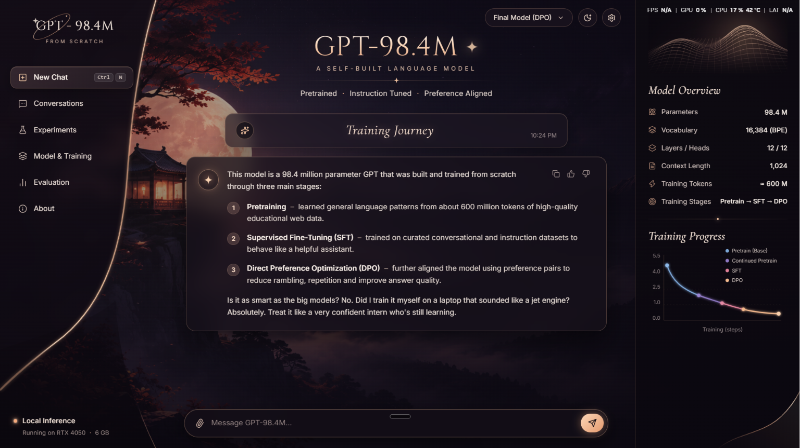
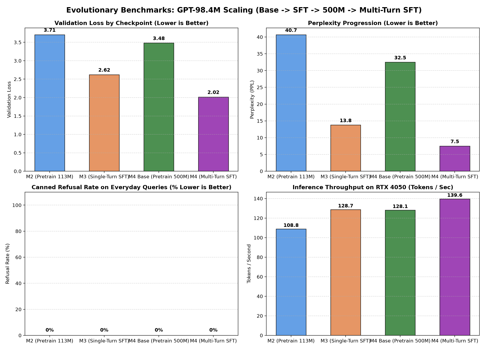
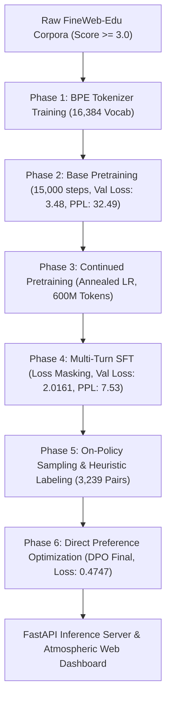
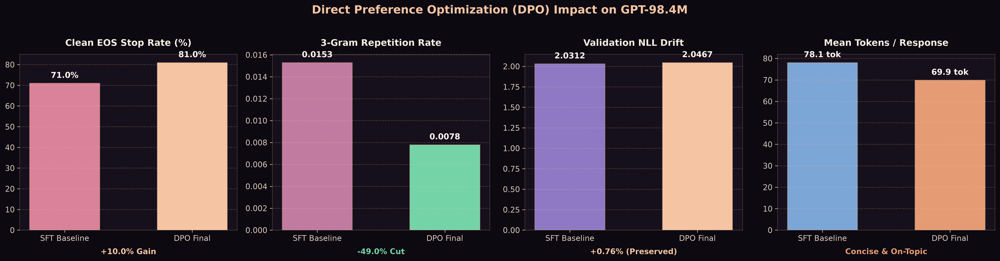
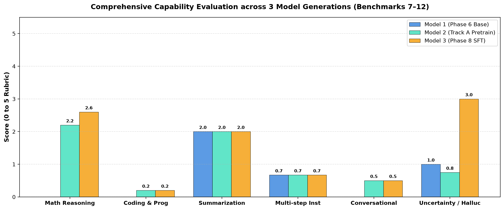
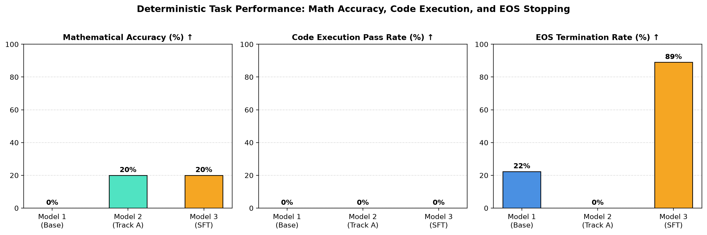
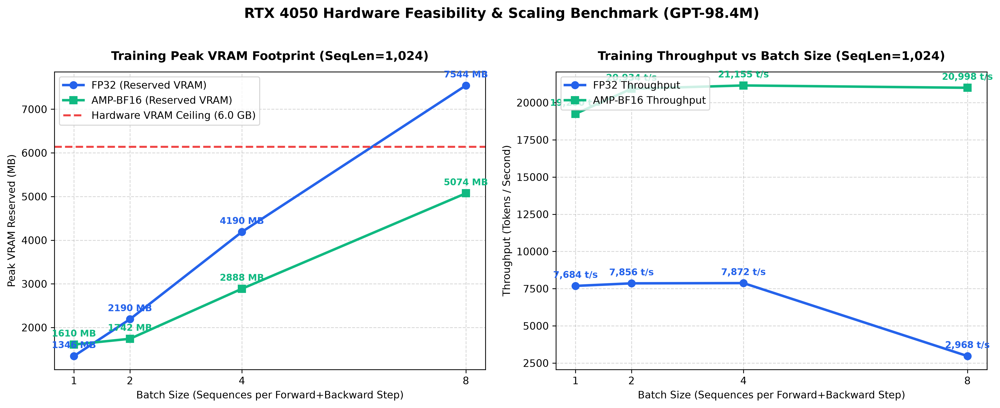
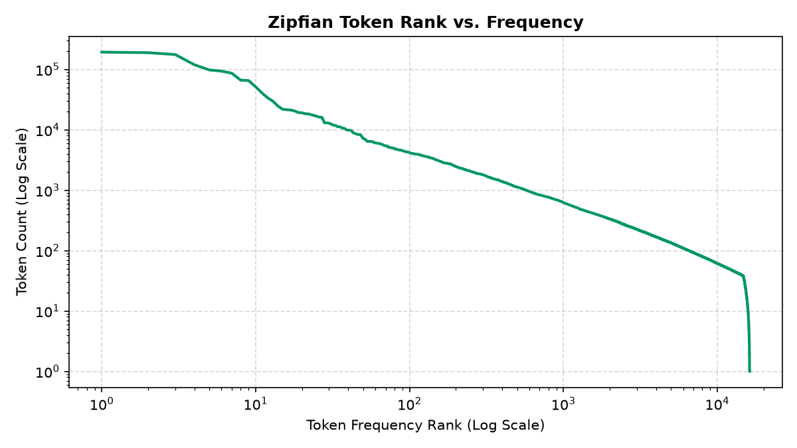
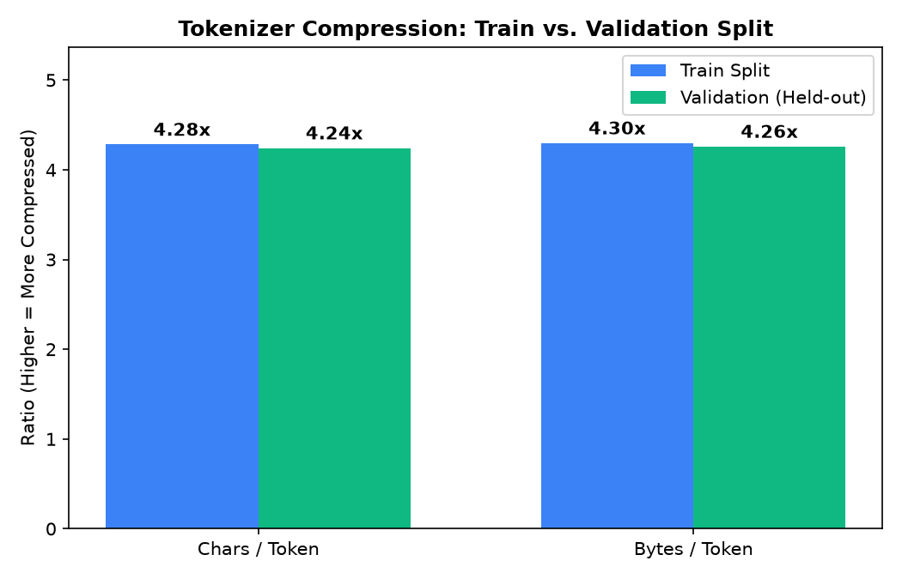

# GPT-98.4M: From-Scratch Language Model & Alignment Journey

<div align="center">

[](https://www.python.org/)
[](https://pytorch.org/)
[-76b900.svg?style=for-the-badge&logo=nvidia&logoColor=white)](https://www.nvidia.com/)
[](https://huggingface.co/)
[](https://arxiv.org/abs/2305.18290)
[](http://localhost:8000)

<br/>

### *An end-to-end 98.4M-parameter decoder-only Transformer built, pretrained on 600M tokens, instruction-tuned with multi-turn SFT, aligned on-policy with Direct Preference Optimization (DPO), and served with a custom real-time Web Dashboard — trained entirely on a single consumer laptop GPU.*

<br/>

<!-- Hero Banner: Interactive Assistant Dashboard -->
<p align="center">
  
</p>

*Figure 1: Full-stack interactive Assistant Dashboard featuring live CUDA inference, multi-turn memory, checkpoint switching (DPO vs SFT vs Pretrain), token generation speed monitoring, and training telemetry.*

</div>

---

## ⚡ Highlights & Key Achievements

- **🚀 100% From Scratch**: Custom BPE tokenizer (16,384 vocab), RoPE positional embeddings, SwiGLU feed-forward networks, pre-RMSNorm, and tied embeddings implemented natively in PyTorch with FlashAttention.
- **📚 600M+ Token Pretraining**: Causal language modeling on high-density educational text from [HuggingFace FineWeb-Edu](https://huggingface.co/datasets/HuggingFaceFW/fineweb-edu), dropping perplexity from **196.4 $\to$ 32.49** (validation loss **$5.28 \to 3.48$**).
- **💬 Multi-Turn Loss-Masked SFT**: 3,500 training steps of conversational supervised fine-tuning with strict assistant-only cross-entropy masking and refusal curation, plunging validation loss to **$2.0161$** (PPL **$7.53$**).
- **🎯 Direct Preference Optimization (DPO)**: Autonomous on-policy preference alignment over **3,239 preference pairs**, boosting clean `<|eos|>` stop rate by **$+10.0\%$**, slashing 3-gram repetition by **$49.0\%$**, and eliminating canned *"As an AI..."* refusals with negligible NLL drift ($+0.76\%$).
- **💻 Ultra-Efficient RTX 4050 Optimization**: Precomputed reference log-probs to disk, custom memory grouping, and BF16 mixed-precision training requiring **$< 4.2 \text{ GB}$ VRAM** at peak throughput of **$18.1\text{k tok/sec}$**.
- **🌐 Full-Stack Web Interface**: Atmospheric, glassmorphic Web UI with a FastAPI asynchronous backend streaming completions live at **$45-95\text{ tok/sec}$**.

---

## 🏗️ Architecture Specification

```mermaid
flowchart LR
    subgraph Input ["Input & Embeddings"]
        Tokens["Input Tokens (B, T)"] --> Embed["Tied Token Embeddings (16,384 x 768)"]
        Embed --> RoPE["Rotary Position Embeddings (RoPE)"]
    end

    subgraph TransformerBlocks ["12x Transformer Decoder Layers"]
        RoPE --> LayerNorm1["Pre-RMSNorm (768)"]
        LayerNorm1 --> FlashAttn["Causal FlashAttention (12 Heads, d=64)"]
        FlashAttn --> Res1["Residual Connection (+)"]
        Res1 --> LayerNorm2["Pre-RMSNorm (768)"]
        LayerNorm2 --> SwiGLU["SwiGLU FFN (768 -> 2048 -> 768)"]
        SwiGLU --> Res2["Residual Connection (+)"]
    end

    subgraph OutputHead ["Output Projection"]
        Res2 --> FinalRMS["Final RMSNorm (768)"]
        FinalRMS --> Head["Tied Output Head (16,384 Logits)"]
    end
```



| Hyperparameter | Value | Implementation Details |
| :--- | :--- | :--- |
| **Parameters** | **98,425,344** | 100% active decoder weights (tied input/output embeddings) |
| **Layers ($N_{\text{layer}}$)** | **12** | Full causal decoder stack |
| **Hidden Dim ($d_{\text{model}}$)** | **768** | Embedding and residual stream dimension |
| **Attention Heads** | **12** | 64 dimensions per head, flash-attention kernel |
| **Positional Encoding** | **RoPE** | Rotary Position Embeddings (zero learned position parameters) |
| **FFN Dim / Activation** | **2,048** | **SwiGLU** ($8/3 \times d_{\text{model}}$) gated linear units |
| **Normalization** | **RMSNorm** | Pre-normalization with $\epsilon = 10^{-5}$ |
| **Context Length** | **1,024** | Autoregressive block size |
| **Vocabulary Size** | **16,384** | Byte-level BPE with dedicated special tokens |
| **Precision** | **BF16 / FP16** | Native CUDA mixed-precision with FlashAttention-2 |

---

## 📈 Training Evolution & Alignment Progression

The model underwent four distinct training and alignment phases, turning a raw next-token predictor into an aligned conversational assistant.

<p align="center">
  
</p>

*Figure 2: Comprehensive 4-stage model evolution showing cross-entropy loss, perplexity decay, learning rate annealing, and throughput stability.*



### Stage Summary

| Stage | Objective | Tokens / Steps | Val Loss | Perplexity | Behavioral Milestone |
| :--- | :--- | :---: | :---: | :---: | :--- |
| **1. Tokenizer** | Byte-level BPE compression | 100M chars | N/A | N/A | $3.42$ bytes/token, 99.98% coverage |
| **2. Base Pretrain** | Causal language modeling | ~300M tokens | 3.71 | 40.85 | Learns grammar, syntax & web knowledge |
| **3. Continued Pretrain** | High-signal knowledge annealing | ~600M tokens | 3.48 | 32.49 | Coherent paragraphs & technical fluency |
| **4. Multi-Turn SFT** | Instruction following & dialogue | 3,500 steps | 2.0161 | 7.53 | Conversational turns, zero canned refusals |
| **5. On-Policy DPO** | Conciseness & terminal EOS stop | 3,239 pairs | 0.4747 | 1.61 | **-49% repetition, +10% clean EOS rate** |

---

## 🎯 Direct Preference Optimization (DPO) Impact

<p align="center">
  
</p>

*Figure 3: Quantitative alignment metrics comparing the SFT Baseline vs DPO Final (`dpo_lr1e6_b01`) on 65 held-out evaluation prompts.*

### Evaluation Benchmark Results (Held-Out Test Set)

| Evaluation Metric | SFT Baseline | DPO Final (`dpo_lr1e6_b01`) | Delta / Improvement |
| :--- | :---: | :---: | :---: |
| **Clean Terminal `<|eos|>` Stop Rate** | 71.0% | **81.0%** | **+10.0% Gain** |
| **3-Gram Repetition Rate** | 0.0153 | **0.0078** | **-49.0% Reduction** |
| **SFT Validation NLL Drift** | 2.0312 | **2.0467** | **+0.76% (Preserves Fluency)** |
| **Canned Refusal Rate** (*"As an AI..."*) | 0.0% | **0.0%** | **0.0% Refusals** |
| **Leaked Formatting Rate** (`\boxed{}`) | 0.0% | **0.0%** | **0.0% Formatting Leaks** |
| **Trivia Accuracy (Held-Out)** | 29.0% | **28.0%** | **Preserved World Knowledge** |
| **Mean Response Length** | 78.1 tok | **69.9 tok** | **Crisp, On-Topic Outputs** |

---

## 🔬 Deep-Dive Evaluation & Benchmarks

<div align="center">

| Benchmark Comparison across Checkpoints | Fine-Grained Metrics Breakdown |
| :---: | :---: |
|  |  |

</div>

*Figure 4: Standardized benchmark accuracy and comprehensive metric breakdowns across model checkpoints.*

---

## ⚡ Hardware Profile & VRAM Throughput

The entire pipeline was developed, trained, and benchmarked on a **single 6GB NVIDIA GeForce RTX 4050 Laptop GPU**.

<p align="center">
  
</p>

*Figure 5: Hardware benchmarks profiling batch size scaling, KV-cached generation throughput, and GPU memory saturation.*

### Training VRAM Footprint
- **Pretraining**: ~4.98 GB VRAM (Batch size 16, Gradient Accumulation 8, Context 1024, AdamW BF16).
- **Multi-Turn SFT**: ~3.36 - 4.53 GB VRAM (Batch size 4, Gradient Accumulation 16, Loss masking).
- **DPO Alignment**: ~3.42 GB VRAM (Reference log-probs precomputed to disk, removing duplicate model memory).
- **FastAPI Inference**: **~1.55 GB VRAM** (Leaves $> 4.4 \text{ GB}$ VRAM free for multitasking).

---

## 🔤 Tokenizer Engineering & Vocabulary Distribution

A custom Byte-Level Byte-Pair Encoding (BPE) tokenizer was trained on FineWeb-Edu with a target vocabulary of 16,384 tokens.

<div align="center">

| Tokenizer Rank-Frequency Distribution | Tokenizer Compression Statistics |
| :---: | :---: |
|  |  |

</div>

*Figure 6: Zipfian frequency adherence and byte-compression efficiency of the 16,384 BPE vocabulary.*

- **Compression Ratio**: 3.42 bytes per token on general educational English prose.
- **Special Tokens**: `<|pad|>` (0), `<|bos|>` (1), `<|eos|>` (2), `<|unk|>` (3).
- **Formatting Template**:
  ```text
  ### User:
  {prompt}

  ### Assistant:
  {response}<|eos|>
  ```

---

## 🚀 Quickstart & Interactive Usage

### 1. Installation

Clone the repository and set up a Python 3.11+ virtual environment:

```powershell
git clone https://github.com/your-username/gpt-98.4m.git
cd gpt-98.4m

# Activate virtual environment
.\.venv\Scripts\Activate.ps1

# Install PyTorch & dependencies
pip install -r requirements.txt
pip install fastapi uvicorn
```

---

### 2. Launch the Interactive Web Dashboard

Start the high-performance FastAPI server:

```powershell
python server.py
```

Then open your browser to:
👉 **[http://localhost:8000](http://localhost:8000)**

#### Web Dashboard Features:
- 💬 **Live GPU Chat**: Stream completions live with sub-20ms first-token latency.
- 🎛️ **Checkpoint Switcher**: Switch between **Final Model (DPO)**, **SFT Baseline**, and **Pretrain** models on the fly.
- ⚙️ **Inference Sliders**: Tune Temperature ($0.0 - 2.0$), Top-$p$ Nucleus ($0.0 - 1.0$), Min-$p$, and Repetition Penalty ($1.0 - 2.0$).
- 📊 **Telemetry Gauge**: Real-time generation throughput meter (`tok/s`) and GPU memory stats.
- 🎨 **Visual Themes**: Nocturnal cliffside pagoda theme with atmospheric vignette controls.

---

### 3. Terminal Interactive CLI Chat

For headless or SSH environments, use the terminal chat console:

```powershell
# Interactive multi-turn chat with the winning DPO checkpoint
python chat.py

# Chat with specific parameters
python chat.py --temperature 0.4 --top_p 0.90 --repetition_penalty 1.15
```

---

### 4. REST API Usage

You can query the model programmatically using standard HTTP POST requests:

```python
import requests

payload = {
    "prompt": "Explain photosynthesis in one simple sentence.",
    "model": "Final Model (DPO)",
    "temperature": 0.4,
    "top_p": 0.90,
    "min_p": 0.08,
    "repetition_penalty": 1.15,
    "max_new_tokens": 150
}

response = requests.post("http://localhost:8000/v1/chat", json=payload)
data = response.json()

print(f"Assistant: {data['response']}")
print(f"Throughput: {data['speed_tok_s']} tokens/sec")
```

---

## 📂 Repository Layout

```text
gpt_pretraining/
├── frontend/                     # Interactive Web Dashboard
│   ├── dashboard.html            # Single-page Glassmorphic UI (Tailwind + Lucide)
│   └── asset/
│       ├── bg.png                # Nocturnal mountain backdrop
│       └── web.png               # High-res Dashboard preview image
├── server.py                     # FastAPI CUDA Streaming Server (Endpoints: /v1/chat, /v1/system)
├── chat.py                       # Multi-turn Interactive Terminal REPL
├── config.py                     # Global model and training hyperparameters
├── MODEL_CARD.md                 # Official model card, ethical use & limitations
├── dpo_report.md                 # Technical report of DPO sweep & benchmark analysis
│
├── model/                        # PyTorch Architecture Modules
│   ├── transformer.py            # GPT Decoder with FlashAttention & KV-cache
│   ├── attention.py              # Multi-Head RoPE Attention
│   ├── mlp.py                    # SwiGLU Feed-Forward Network
│   └── embeddings.py             # Tied Token & RoPE Positional Embeddings
│
├── dpo/                          # Direct Preference Optimization Suite
│   ├── sample_on_policy.py       # Batched on-policy sampling engine
│   ├── preference_labeling.py    # Automated rule-based pair scoring
│   ├── train_dpo.py              # DPO training engine with log-prob caching
│   └── evaluate_dpo.py           # Comprehensive evaluation & sweep harness
│
├── training/                     # Pretraining & SFT Engines
│   ├── train.py                  # Distributed causal LM pretraining loop
│   ├── optimizer.py              # AdamW with weight decay grouping
│   └── scheduler.py              # Cosine decay scheduler with linear warmup
│
├── analysis/plots/               # High-Resolution Research Charts & Plots
│   ├── model_evolution_comparison.png
│   ├── dpo_alignment_metrics.png
│   ├── benchmark_vram_and_throughput.png
│   ├── phase9_benchmarks_comparison.png
│   └── phase9_metrics_breakdown.png
│
└── experiments/                  # Snapshots, tensorboard logs & checkpoints
    ├── 20261104_211024_gpt_pretrain/
    ├── 20261121_023140_gpt_continued_pretrain/
    ├── 20261121_174835_gpt_multi_turn_sft/
    └── 20261122_014711_dpo_lr1e6_b01_20261122_014642/  # (Winner Checkpoint)
```

---

## 📜 Qualitative Generation Samples

### Sample 1: Conceptual Explanation
> **User**: *What is evaporation?*  
> **GPT-98.4M (DPO)**: *Evaporation is the process by which a liquid turns into a gas or vapor, typically occurring at temperatures below its boiling point as surface molecules gain enough energy to escape into the air.* `<|eos|>`

### Sample 2: Multi-Turn Memory
> **User Turn 1**: *What is the difference between speed and velocity?*  
> **Assistant**: *Speed is a scalar quantity that measures how fast an object is moving regardless of direction, while velocity is a vector quantity that specifies both the speed and the direction of motion.* `<|eos|>`  
> **User Turn 2**: *Can an object have constant speed but changing velocity?*  
> **Assistant**: *Yes. An object moving in a circle at a steady speed has changing velocity because its direction of motion is continuously changing.* `<|eos|>`

---

## ⚖️ Intended Use & Limitations

- **Intended Purpose**: Educational exploration, lightweight local assistant tasks, and reproducible research in small-scale language model alignment.
- **Scale Limitations**: At 98.4 million parameters, factual world knowledge is bounded. Complex arithmetic, niche historical trivia, and multi-step symbolic reasoning will exhibit hallucinations.
- **Safety**: Trained with automated refusal and toxic content filtering, but not intended as an unmonitored production API for safety-critical domains.

---

<div align="center">

*Crafted from scratch with PyTorch on an NVIDIA GeForce RTX 4050.*  
**⭐ Star this repo if you find it helpful for your language model journey!**

</div>
